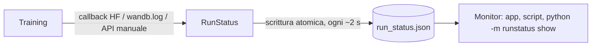

# runstatus

Un file di stato **scritto dal training mentre gira**, letto da un monitor (app, dashboard, script) senza fare
parsing dei log. Generico: funziona per SFT, RL (GRPO/PPO), eval e loop custom. Solo libreria standard;
`transformers` e `wandb` sono opzionali.

Pensato per l'app [ClusterControl](https://github.com/GiuseppeBellamacina/cluster-control-android), che pilota una catena
di job SLURM dal telefono; il formato però non dipende da nessuna app.



## Cosa vedi

`python -m runstatus show logs/run_status.json` (aggiungi `--watch` per aggiornarlo ogni 2 s), con il file di esempio
[`examples/sample_run_status.json`](examples/sample_run_status.json):

```
grpo-demo  [rl]  RUNNING  phase=grpo
██████████████░░░░░░  70.0%  step 350/500
  loss             0.06497  █▅▄▃▃▃▂▂▂▂▂▂▁▁▂▁▁▁▁▁▁▁▁▁▁▁▁▁▁▁▁▁▁▁▁  best 0.0609
  reward             0.904  ▁▁▁▁▁▂▂▂▃▃▃▃▃▃▄▄▄▄▄▅▅▅▅▅▆▆▆▇▆▇▇▇▇▇█  best 0.904 avg 0.5064
  rewards/format       0.9  ▁▁▁▁▁▁▁▁▁▁▁▁▁▁▁▁▁▁▁▁▁▁▁▁▁▁▁▁▁▁▁▁▁▁▁  best 0.9 avg 0.9
  eval_loss        0.05774  █▃▁  best 0.05774
  · 14:49:03 checkpoint saved at step 100
  · 14:49:03 checkpoint saved at step 200
```

Prova subito: `PYTHONPATH=src python examples/fake_rl_train.py out.json && PYTHONPATH=src python -m runstatus show out.json`.

## Uso in 30 secondi

```python
from runstatus import RunStatus

status = RunStatus("logs/run_status.json", kind="train", name="my-run", total_steps=1000)  # o env RUNSTATUS_PATH
status.set(phase="sft")
status.log(step, loss=0.4, lr=1e-4)        # qualsiasi metrica numerica
status.finish()                            # oppure status.fail("motivo")
```

Come context manager chiude da solo (`finished`, oppure `failed` se esce con un'eccezione):

```python
with RunStatus(...) as status:
    ...
```

### HuggingFace Trainer / TRL (anche GRPO e PPO)

```python
from runstatus.hf import RunStatusCallback
Trainer(..., callbacks=[RunStatusCallback(status, phase="grpo")])
```

### wandb (anche offline)

```python
import wandb
from runstatus.wandb_hook import attach_wandb
wandb.init(...)
attach_wandb(status)      # ogni wandb.log finisce anche nel file; salva id e modalità del run
```

## Configurazione

**`RunStatus(...)`**

| Opzione | Default | A cosa serve |
| --- | --- | --- |
| `path` | `$RUNSTATUS_PATH` o `logs/run_status.json` | dove scrivere |
| `kind`, `name`, `total_steps` | `"train"`, `None`, `None` | etichette e calcolo di % ed ETA |
| `include` / `exclude` | tutte / nessuna | glob sui nomi delle metriche, es. `exclude=["debug/*"]` |
| `rename` | nessuno | `{"learning_rate": "lr"}` |
| `best` | automatico | `{"eval_acc": "max"}`; di default `*loss*` min, `*reward*`/`*acc*`/`*f1*`/`*bleu*`… max |
| `average` | `["*reward*"]` | metriche con media totale, media mobile (`window`, default 50) e min/max: utile in RL |
| `series` | tutte | quali metriche tengono lo storico per i grafici |
| `max_points` | 400 | oltre questo le serie vengono decimate (un punto ogni 2, 4, ...) |
| `throttle` | 2 s | intervallo minimo tra due scritture (fase, eval, eventi, fine: scritte subito) |
| `extra` | `{}` | dict libero (iperparametri, git sha, ...) sotto `"extra"` |
| `compat_keys` | `True` | scrive anche le chiavi piatte `step, total_steps, phase, loss, reward, ...` |

**`RunStatusCallback(status, ...)`**: `phase`, `transform(logs, state) -> dict` (calcola o filtra metriche prima della
registrazione, es. deviazione standard delle reward), `log_eval`, `track_eval` (segnala l'eval in corso),
`on_save_event` (evento a ogni checkpoint), `extra`.

**Altre chiamate**: `status.set(phase=, note=, epoch=, samples=, eval_active=, eval_progress=, extra=, wandb=)`,
`status.event("testo")` per eventi liberi (restano gli ultimi 20).

## Il file (schema 2)

```json
{
 "schema": 2,
 "run": {"id": "84f434a4", "name": "grpo-demo", "kind": "rl", "phase": "grpo", "state": "running",
         "started_at": "...", "updated_at": "...", "host": "node01", "pid": 41888, "slurm_job_id": null},
 "progress": {"step": 350, "total_steps": 500, "epoch": null, "pct": 70.0, "eta_s": 480, "steps_per_s": 1.2},
 "metrics": {
   "latest": {"loss": 0.065, "reward": 0.904, "kl": 0.01},
   "best":   {"loss": 0.061, "reward": 0.904},
   "mean":   {"reward": 0.506},  "moving": {"reward": 0.71},
   "stats":  {"reward": {"min": 0.076, "max": 0.904}}
 },
 "series": {"loss": [[10, 0.33], [20, 0.23]], "reward": [[10, 0.10], [20, 0.08]]},
 "eval": {"active": false, "progress": null},
 "wandb": {"id": "dew3jc9h", "url": null, "mode": "offline"},
 "samples": [], "events": [{"t": "...", "step": 100, "msg": "checkpoint saved at step 100"}],
 "extra": {"model": "demo-0.5b", "lr": 1e-05},
 "gpu": {"mem_gb": 11.4},
 "note": null
}
```

Garanzie: scrittura atomica (un lettore non vede mai un file a metà), nessuna eccezione verso il training (al primo
errore l'helper si disattiva e lo dice una volta), `NaN` e valori non numerici ignorati. L'ETA usa il ritmo osservato
da questo avvio, quindi regge anche il resume da checkpoint. Con più processi scrivono solo quello principale.

## Test

```
pip install pytest && pytest
```

Provato anche con `transformers` e `wandb` reali (modalità offline).
