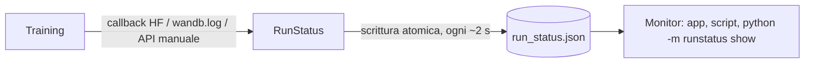

# runstatus

Un file di stato **scritto dal training mentre gira**, letto da un monitor (app, dashboard, script) senza fare
parsing dei log. Generico: funziona per SFT, RL (GRPO/PPO), eval e loop custom. Solo libreria standard;
`transformers` e `wandb` sono opzionali.

Pensato per l'app [ClusterControl](https://github.com/GiuseppeBellamacina/cluster-control-android), che pilota una catena
di job SLURM dal telefono; il formato però non dipende da nessuna app.



## Cosa vedi

`python -m runstatus show run_status/<jobid>.json` (aggiungi `--watch` per aggiornarlo ogni 2 s), con il file di esempio
[`examples/sample_run_status.json`](examples/sample_run_status.json):

```
grpo-demo  [rl]  RUNNING  phase=grpo
██████████████░░░░░░  70.0%  step 350/500
  loss             0.06497  █▅▄▃▃▃▂▂▂▂▂▂▁▁▂▁▁▁▁▁▁▁▁▁▁▁▁▁▁▁▁▁▁▁▁  best 0.0609
  reward             0.904  ▁▁▁▁▁▂▂▂▃▃▃▃▃▃▄▄▄▄▄▅▅▅▅▅▆▆▆▇▆▇▇▇▇▇█  best 0.904 avg 0.5064
  rewards/format       0.9  ▁▁▁▁▁▁▁▁▁▁▁▁▁▁▁▁▁▁▁▁▁▁▁▁▁▁▁▁▁▁▁▁▁▁▁  best 0.9 avg 0.9
  eval_loss        0.05774  █▃▁  best 0.05774
  · 14:49:03 checkpoint saved at step 100
  · 14:49:03 checkpoint saved at step 200
```

Prova subito: `PYTHONPATH=src python examples/fake_rl_train.py out.json && PYTHONPATH=src python -m runstatus show out.json`.

## Uso in 30 secondi

```python
from runstatus import RunStatus

status = RunStatus("run_status/run.json", kind="train", name="my-run", total_steps=1000)  # o env RUNSTATUS_PATH
status.set(phase="sft")
status.log(step, loss=0.4, lr=1e-4)        # qualsiasi metrica numerica
status.finish()                            # oppure status.fail("motivo")
```

Come context manager chiude da solo (`finished`, oppure `failed` se esce con un'eccezione):

```python
with RunStatus(...) as status:
    ...
```

### HuggingFace Trainer / TRL (anche GRPO e PPO)

```python
from runstatus.hf import RunStatusCallback
Trainer(..., callbacks=[RunStatusCallback(status, phase="grpo")])
```

### wandb (anche offline)

```python
import wandb
from runstatus.wandb_hook import attach_wandb
wandb.init(...)
attach_wandb(status)      # ogni wandb.log finisce anche nel file; salva id e modalità del run
```

## Configurazione

**`RunStatus(...)`**

| Opzione | Default | A cosa serve |
| --- | --- | --- |
| `path` | `$RUNSTATUS_PATH`, altrimenti `<$RUNSTATUS_DIR o run_status>/<jobid>.json` sotto SLURM, `.../run_status.json` altrimenti | dove scrivere: una cartella dedicata, separata dai log dello scheduler (le serie vanno in `<nome>.series.json`) |
| `keep_days` | 30 | all'avvio cancella, nella stessa cartella, i **propri** file (`<jobid>.json`, `<jobid>.series.json`, `run_status.json`) più vecchi di N giorni; `None` per non cancellare |
| `kind`, `name`, `total_steps` | `"train"`, `None`, `None` | etichette e calcolo di % ed ETA |
| `include` / `exclude` | tutte / nessuna | glob sui nomi delle metriche, es. `exclude=["debug/*"]` |
| `rename` | nessuno | `{"learning_rate": "lr"}` |
| `best` | automatico | `{"eval_acc": "max"}`; di default `*loss*` min, `*reward*`/`*acc*`/`*f1*`/`*bleu*`… max |
| `average` | `["*reward*"]` | metriche con media totale, media mobile (`window`, default 50) e min/max: utile in RL |
| `series` | tutte | quali metriche tengono lo storico per i grafici |
| `max_points` | 200 | oltre questo le serie vengono decimate (un punto ogni 2, 4, ...) |
| `throttle` | 2 s | intervallo minimo tra due scritture (fase, eval, eventi, fine: scritte subito) |
| `extra` | `{}` | dict libero (iperparametri, git sha, ...) sotto `"extra"` |

**`RunStatusCallback(status, ...)`**: `phase`, `transform(logs, state) -> dict` (calcola o filtra metriche prima della
registrazione, es. deviazione standard delle reward), `log_eval`, `track_eval` (segnala l'eval in corso),
`on_save_event` (evento a ogni checkpoint), `extra`.

**Altre chiamate**: `status.set(phase=, note=, epoch=, samples=, eval_active=, eval_progress=, extra=, wandb=)`,
`samples` accetta anche oggetti, es. `{"prompt": ..., "output": ..., "match": true, "rewards": {"bleu_reward": 0.5}, "total": 0.5}`
(l'app mostra le reward per componente). `status.event("testo")` per eventi liberi (restano gli ultimi 20). `status.set(phase="grpo", reset_series=True)` azzera i
grafici quando il contatore di step riparte (es. SFT poi GRPO nello stesso processo).

## Che cosa sta girando: fasi, algoritmo, modello

Il file dice anche *che tipo* di run è, così il monitor può mostrarlo (con le icone) senza saperne nulla in anticipo:

```python
status = RunStatus(
    kind="train", name="my-run",
    method="grpo",                                                   # sft, grpo, ppo, dpo, supervised, pretraining, ...
    model={"family": "llm", "name": "Qwen2.5-0.5B", "params": "0.5B"},  # family: llm, nn, cnn, transformer, ml, ...
    stages=["sft", "grpo", {"id": "eval", "label": "Valutazione", "icon": "eval"}],   # il piano, mostrato come stepper
    badges=["LoRA", {"label": "4-bit", "icon": "gpu"}],              # chip liberi
)
status.stage("sft", total_steps=7770)    # entra nella fase: chiude la precedente, riparte da zero
status.stage("grpo", method="grpo")      # una fase fuori piano viene aggiunta
status.describe(method="ppo")            # cambia i metadati in qualsiasi momento
```

`stage()` chiude la fase precedente salvando lo step raggiunto, azzera contatori e grafici (`reset=False` per tenerli) e
aggiorna `phase`. `finish()`/`fail()` chiudono l'ultima fase come `done`/`failed`. Le icone sono id semplici: il monitor
li traduce in un disegno e, se non li conosce, mostra il testo (un emoji va bene). Ids conosciuti da ClusterControl:
`train`, `eval`, `inference`, `sft`, `grpo`, `ppo`, `dpo`, `rl`, `pretrain`, `finetune`, `distill`, `llm`, `nn`, `cnn`,
`rnn`, `transformer`, `ml`, `tree`, `diffusion`, `vision`, `speech`, `gpu`, `data`.

## Monitoring con ClusterControl in 3 righe

[ClusterControl](https://github.com/GiuseppeBellamacina/cluster-control-android) legge questi file via ssh: non fa parsing
dei log. Nel tuo train:

```python
from runstatus import RunStatus
from runstatus.hf import RunStatusCallback

status = RunStatus(kind="train", name="my-run")                 # sotto SLURM scrive run_status/<jobid>.json
trainer = Trainer(..., callbacks=[RunStatusCallback(status)])   # HF/TRL; in un loop custom: status.log(step, loss=...)
```

Contratto con l'app (il `cluster_helper.sh` del progetto lo implementa; vedi t2g):

| Cosa | Dove |
| --- | --- |
| stato corrente (piccolo, riletto a ogni poll) | `<cartella progetto>/run_status/<SLURM_JOB_ID>.json` |
| serie per i grafici | `<SLURM_JOB_ID>.series.json` accanto, scritto ogni ~15 s e a fine run |
| campi usati dall'app | `run.kind/phase/state/method/model/stage/stages/badges`, `progress.step/total_steps/pct/eta_s`, `metrics.latest/best/mean`, `eval.active`, `series` |

Il job deve girare con la cartella del progetto come directory corrente (o impostare `RUNSTATUS_PATH`), e il nome SLURM
`train-<tag>` / `eval-<tag>` come richiede l'app. Installazione: `pip install https://github.com/GiuseppeBellamacina/runstatus/archive/refs/tags/v0.2.0.zip`.

## Il file (schema 3)

```json
{
 "schema": 2,
 "run": {"id": "84f434a4", "name": "grpo-demo", "kind": "rl", "phase": "grpo", "state": "running",
         "started_at": "...", "updated_at": "...", "host": "node01", "pid": 41888, "slurm_job_id": null},
 "progress": {"step": 350, "total_steps": 500, "epoch": null, "pct": 70.0, "eta_s": 480, "steps_per_s": 1.2},
 "metrics": {
   "latest": {"loss": 0.065, "reward": 0.904, "kl": 0.01},
   "best":   {"loss": 0.061, "reward": 0.904},
   "mean":   {"reward": 0.506},  "moving": {"reward": 0.71},
   "stats":  {"reward": {"min": 0.076, "max": 0.904}}
 },
 "eval": {"active": false, "progress": null},
 "wandb": {"id": "dew3jc9h", "url": null, "mode": "offline"},
 "samples": [], "events": [{"t": "...", "step": 100, "msg": "checkpoint saved at step 100"}],
 "extra": {"model": "demo-0.5b", "lr": 1e-05},
 "gpu": {"mem_gb": 11.4},
 "series_file": "123.series.json", "note": null
}
```

Sidecar `<nome>.series.json` (valori a 6 cifre significative): `{"schema": 3, "run_id": "...", "total_steps": 500, "phase": "grpo", "series": {"loss": [[10, 0.33], [20, 0.23]], "reward": [[10, 0.10], [20, 0.08]]}}`.

Il totale degli step è sempre coerente: con `RunStatusCallback` viene da `state.max_steps` del Trainer, la percentuale
non supera mai 100 (un passo oltre il totale dichiarato alza il totale) e `total_steps=0` significa "sconosciuto".

Garanzie: scrittura atomica (un lettore non vede mai un file a metà), nessuna eccezione verso il training (al primo
errore l'helper si disattiva e lo dice una volta), `NaN` e valori non numerici ignorati. L'ETA usa il ritmo osservato
da questo avvio, quindi regge anche il resume da checkpoint. Con più processi scrivono solo quello principale.

## Test

```
pip install pytest && pytest
```

Provato anche con `transformers` e `wandb` reali (modalità offline).
